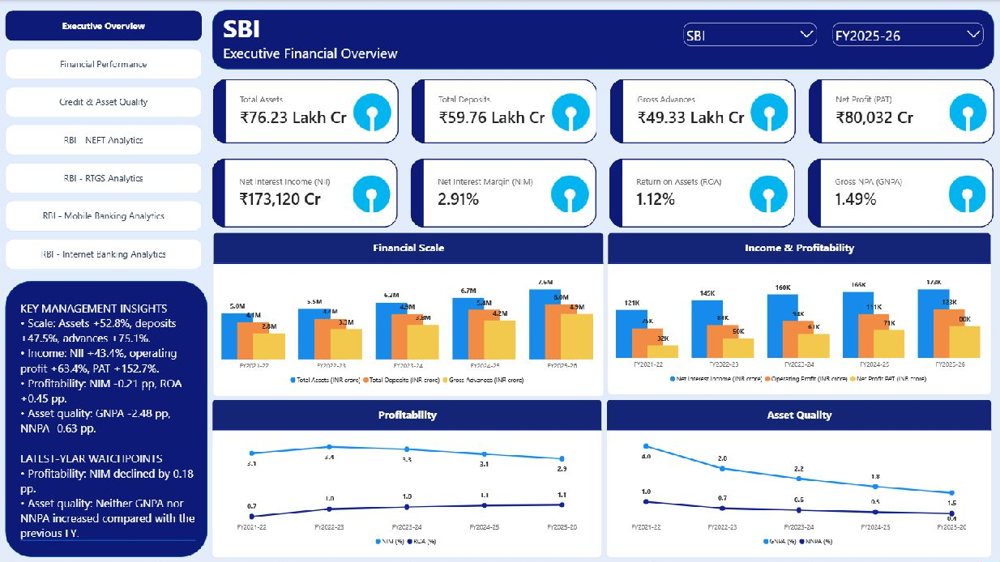
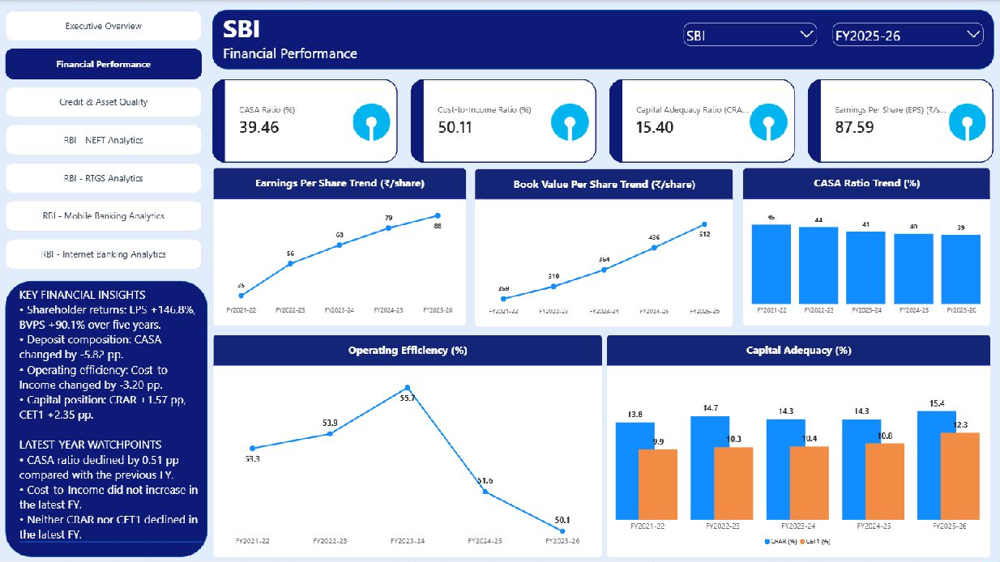
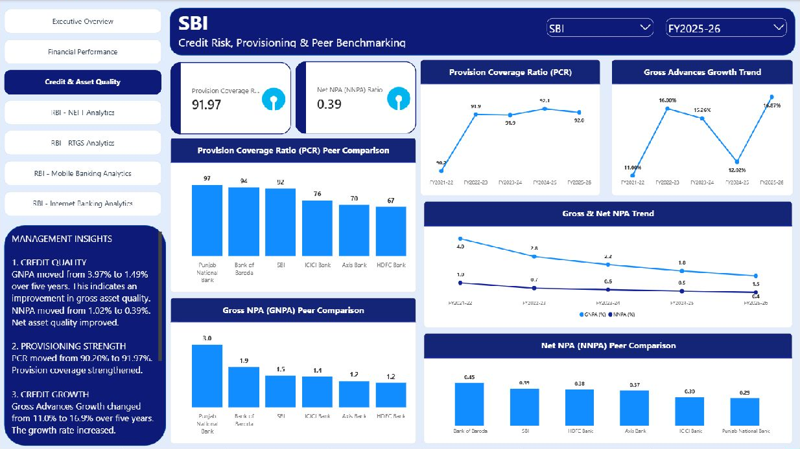
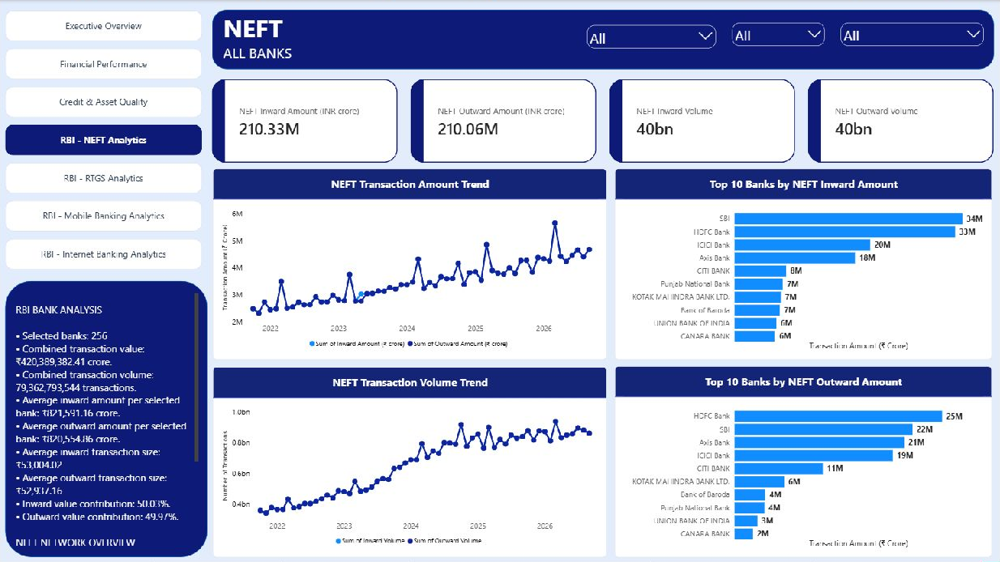
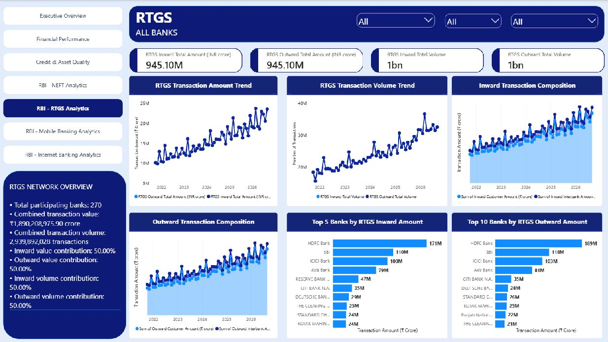
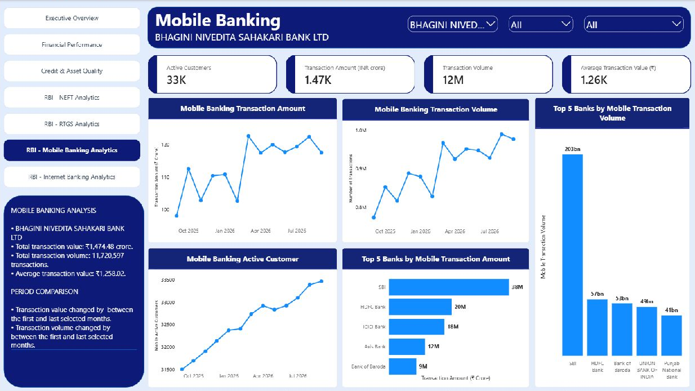
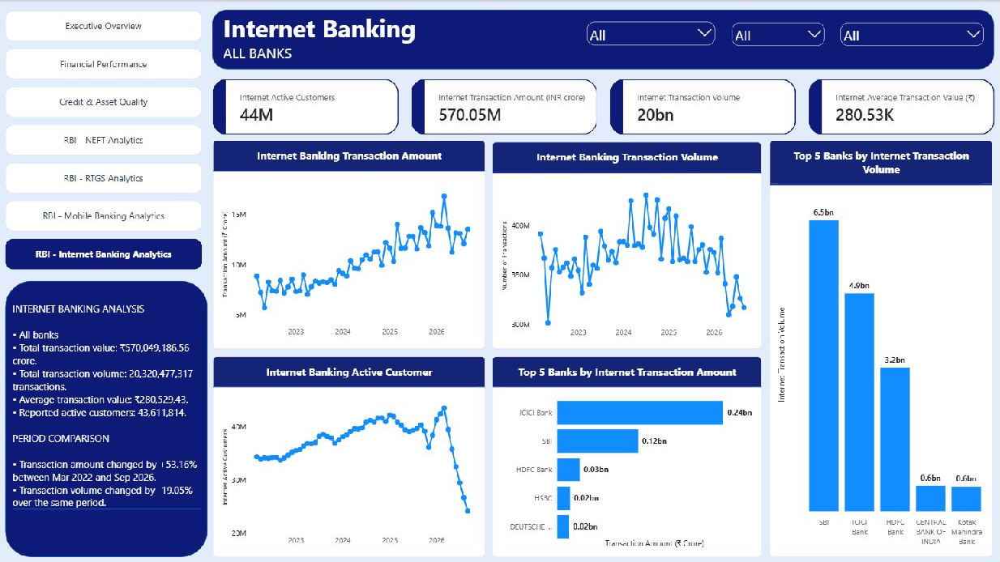

# SBI Financial Performance & Digital Banking Analytics

**Independent Business Analytics Portfolio Project | Power BI | Financial Analytics**

## Project Overview

This project is an independent Business Analytics portfolio case study focused on evaluating the historical financial performance of six major Indian banks and analyzing digital banking transaction trends using publicly available data.

The project combines financial performance indicators with Reserve Bank of India (RBI) digital banking statistics to examine banking performance, asset quality, and the growth of digital banking channels.

The analysis follows a structured Business Analyst approach, covering business problem definition, analytical objectives, data collection, data preparation, KPI analysis, dashboard development, testing, and business recommendations.

## Business Problem

Financial institutions operate in a competitive and evolving banking environment. Understanding financial performance, credit quality, and digital banking activity is essential for evaluating business performance and identifying meaningful trends.

Financial data and digital banking statistics are often presented across different sources and reporting formats, making comparative analysis challenging.

This project brings together historical financial indicators and RBI digital banking statistics into a structured analytical solution to support comparative analysis and business understanding.

## Project Objectives

- Analyze the historical financial performance of selected Indian banks.
- Compare profitability, operational efficiency, and financial growth.
- Evaluate credit performance and asset quality.
- Examine trends in NEFT, RTGS, Mobile Banking, and Internet Banking.
- Develop a KPI-driven Power BI dashboard.
- Translate analytical findings into practical business recommendations.

## Banks Covered

| Bank | Category |
|---|---|
| State Bank of India (SBI) | Public Sector Bank |
| Axis Bank | Private Sector Bank |
| Bank of Baroda | Public Sector Bank |
| HDFC Bank | Private Sector Bank |
| ICICI Bank | Private Sector Bank |
| Punjab National Bank (PNB) | Public Sector Bank |

## Data Scope

### Financial Data

- Financial period: FY2021–22 to FY2025–26
- Banks covered: 6
- Bank-year observations: 30
- Financial KPIs: 23
- Reporting unit: INR crore

### Digital Banking Data

RBI historical digital banking statistics were used to analyze:

- NEFT
- RTGS
- Mobile Banking
- Internet Banking

The digital banking analysis covers historical transaction activity and related trends across the available reporting periods.

Data availability differs across channels. Missing observations are treated as data gaps and are not automatically interpreted as zero activity.

## Power BI Dashboard

The project includes a seven-page Power BI report designed to provide an organized view of financial performance and digital banking trends.

### Dashboard Preview

The screenshots below are taken from the actual Power BI dashboard developed for this project.

### 1. Executive Overview

Provides a consolidated overview of the financial performance of the selected banks and highlights major analytical indicators.

### 2. Financial Performance

Examines financial performance indicators and enables comparative analysis across the selected banks and reporting periods.

### 3. Credit & Asset Quality

Focuses on credit-related indicators and asset quality to support the evaluation of banking stability and lending performance.

### 4. RBI NEFT Analytics

Analyzes historical NEFT transaction trends using RBI data.

### 5. RBI RTGS Analytics

Examines RTGS transaction activity and historical trends.

### 6. RBI Mobile Banking Analytics

Evaluates historical mobile banking transaction trends.

### 7. RBI Internet Banking Analytics

Analyzes historical internet banking transaction activity.

## Key Analytical Areas

### Financial Performance

- Profitability analysis
- Financial growth comparison
- Operational performance
- Peer benchmarking

### Credit & Asset Quality

- Credit performance
- Asset quality indicators
- Comparative banking analysis

### Digital Banking

- NEFT transaction trends
- RTGS transaction trends
- Mobile banking activity
- Internet banking activity
- Historical channel-level comparisons

## Tools & Technologies

| Tool | Purpose |
|---|---|
| Microsoft Power BI | Dashboard development and visualization |
| Microsoft Excel | Data organization and preparation |
| SQL | Data analysis and querying |
| Python | Data processing and analytical support |
| Business Analytics | KPI analysis and business interpretation |
| Data Visualization | Communicating analytical findings |

## Project Methodology

The project was developed through the following analytical workflow:

1. Business problem identification
2. Business objectives and KPI definition
3. Data collection from publicly available sources
4. Data preparation and validation
5. Financial and digital banking analysis
6. Dashboard design and development
7. Functional and analytical testing
8. Business recommendations
9. Project documentation and closure

## Key Deliverables

- Business requirements and project documentation
- Historical financial dataset
- RBI digital banking dataset
- KPI-based financial analysis
- Power BI dashboard
- Dashboard screenshots
- Business recommendations
- Project closure and testing report

## Project Report

The detailed project report documents the analytical process, financial findings, digital banking analysis, dashboard walkthrough, recommendations, testing summary, and project limitations.

[View the Project Closure & Business Recommendations Report](12_Recommendations_Project_Closure/SBI_Project_Closure_and_Business_Recommendations_Report.pdf)

## Interactive Power BI Dashboard

The interactive dashboard is available as a Power BI Desktop file.

[Open the Power BI Dashboard File](10_Solution_Design_Development/01_PowerBI_Dashboard/SBI_Financial_Analytics_Dashboard.pbix)

To explore the dashboard interactively, download the `.pbix` file and open it using Microsoft Power BI Desktop.

## Testing & Validation

The project underwent manual testing covering:

- Data and KPI validation
- Dashboard visual and functional checks
- Simulated User Acceptance Testing (UAT)

The documented testing summary recorded 28 manual test cases as passed, with no failed cases reported.

Testing was performed as part of this independent portfolio project. Simulated UAT does not represent acceptance by any bank or external stakeholder.

## Limitations

- The analysis is based on publicly available historical data.
- The project does not use confidential or customer-level banking information.
- Financial and digital banking data may differ in reporting definitions, periods, and availability.
- Missing data is treated as a limitation rather than assumed to represent zero activity.
- The analysis represents independent analytical interpretation and should not be considered official financial advice or institutional assessment.
- The project does not claim to represent the internal systems, processes, or decisions of any bank.

## Project Disclaimer

This is an independent Business Analytics portfolio project developed for learning and professional demonstration purposes.

The project uses publicly available information and simulated stakeholder inputs. It is not commissioned, approved, endorsed, or validated by State Bank of India (SBI), the Reserve Bank of India (RBI), or any other bank included in the analysis.

No confidential, proprietary, or customer-level banking data was used.

All findings, interpretations, and recommendations represent independent analytical work based on the available historical data.

## Author

**Abhishek Bandwal**

Business Analytics | Financial Analytics | Power BI | SQL | Data Analysis
